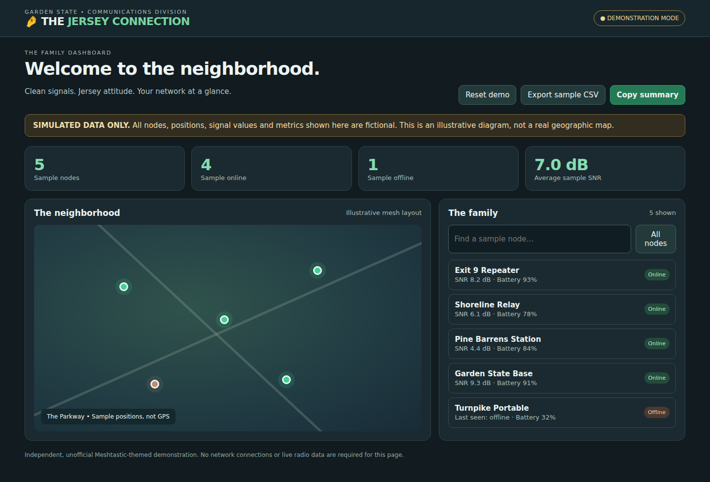
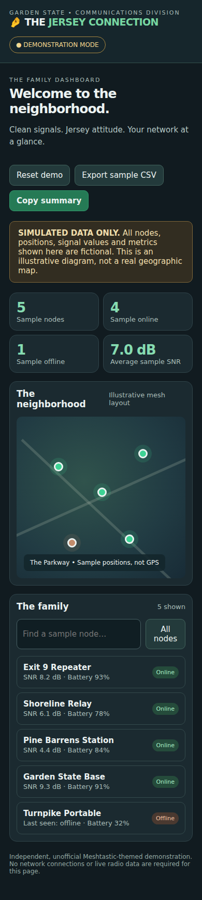

# 🤌 THE JERSEY CONNECTION 🇺🇸
### *Fuggedaboutit. We know where your nodes are.*

**AYYY, HOW YA DOIN', PAISAN?** Welcome to **The Jersey Connection** — a New Jersey-flavored Meshtastic map project. Whether you're stuck on the Turnpike, debating pork roll versus Taylor Ham, or heading down the Shore, here's a way to see who's on the mesh. **What exit you from?**

> **The Family Territory:** The map is nationwide, not just New Jersey. The jokes are Jersey; the radio data is real.

## 📸 The Jersey Connection — Demo Screenshots

The images below are **automatically generated from fictional demonstration data** by GitHub Actions. They are not live Meshtastic nodes or actual GPS positions. The screenshot workflow commits updated PNGs to `screenshots/` on successful runs against `main`.

### Desktop demo

### Mobile-sized preview

## 🍕 What's cookin'?
- **The Family Map:** Explore position-reporting Meshtastic nodes observed through the public MQTT network.
- **Who's This Guy?:** Find a node by name or ID.
- **Fresh Gabagool:** The upstream map updates node data approximately once a minute.
- **Fuggedaboutit:** Nodes without updated positions for eight hours are removed from the upstream map.
- **Who's Talkin' to Who?:** Inspect observed LoRa relationships and neighbor links. Lines do **not** necessarily indicate direct radio connections.
- **The Parkway:** Network connections, with no toll booths.

## 🎨 Garden State colors
The planned Jersey theme uses these colors:

| Jersey flavor | Color |
| --- | --- |
| Garden State green | `#24834B` |
| Turnpike asphalt | `#20252B` |
| Jersey blue | `#003B71` |
| Jersey gold | `#FFCA28` |
| Shore sand | `#F3E8CF` |
| Taylor Ham red | `#C83737` |

These are branding targets, not a claim that every screen has already been restyled.

## 🚗 Intel Mac? AYYY, WE GOTCHU.
**Target:** Intel (x86_64) Mac running macOS Tahoe 26.7.1, with a double-clickable **The Jersey Connection.app** and a downloadable DMG.

**Chosen approach:** A desktop window connecting to the existing online [MeshMap.net](https://meshmap.net/) service. No local map backend or offline node database is planned for this edition.

**Build and release status:** Intel packaging has passed pull-request checks. The automated release workflow publishes successful `main` builds as preview prereleases. Check [GitHub Releases](https://github.com/BaconDisk22/The-Jersey-Connection/releases) for a downloadable DMG and ZIP; availability is not guaranteed until the publishing workflow succeeds. Builds are unsigned and not notarized.

## 📡 How do I get my node in the family?
Your node must report position data to Meshtastic's public MQTT system, either directly or through another reporting node. Read the [official Meshtastic MQTT documentation](https://meshtastic.org/docs/software/integrations/mqtt/) and the public-server restrictions. Think carefully about location privacy before sharing position information.

## 🛠️ For the wiseguys running their own setup
This fork retains the upstream Go ingestion service and website architecture. The original source includes `cmd/meshobserv/`, `internal/`, `website/`, and `Dockerfile.meshobserv`. The map requires a functioning `/nodes.json` data endpoint when independently hosted. A new coat of Jersey paint doesn't magically deploy the backend, capisce?

## 📦 Releases & packages
The application version is **1.0.0-beta.1**. Successful builds from `main` are configured to publish uniquely tagged **preview prereleases** containing an Intel Mac DMG, zipped app, and `SHA256SUMS.txt`. Visit [GitHub Releases](https://github.com/BaconDisk22/The-Jersey-Connection/releases) to confirm an installer is available. Signing and notarization are not configured. To open an unsigned app on macOS, Control-click the app in Finder and choose **Open**; if blocked, use **System Settings → Privacy & Security → Open Anyway** only after verifying the source and checksum.

## 🤝 Respect the family
**The Jersey Connection** is an independent, unofficial themed fork of [MeshMap.net by Brian Shea](https://github.com/brianshea2/meshmap.net). Credit belongs to the original maintainers and Meshtastic contributors; original licensing and copyright notices must be preserved. This project is not an official Meshtastic application and is not affiliated with any television show or commercial brand.

Built with love, radio waves, and enough Jersey attitude to fill the Parkway. **Now pass the disco fries.** 🍟
